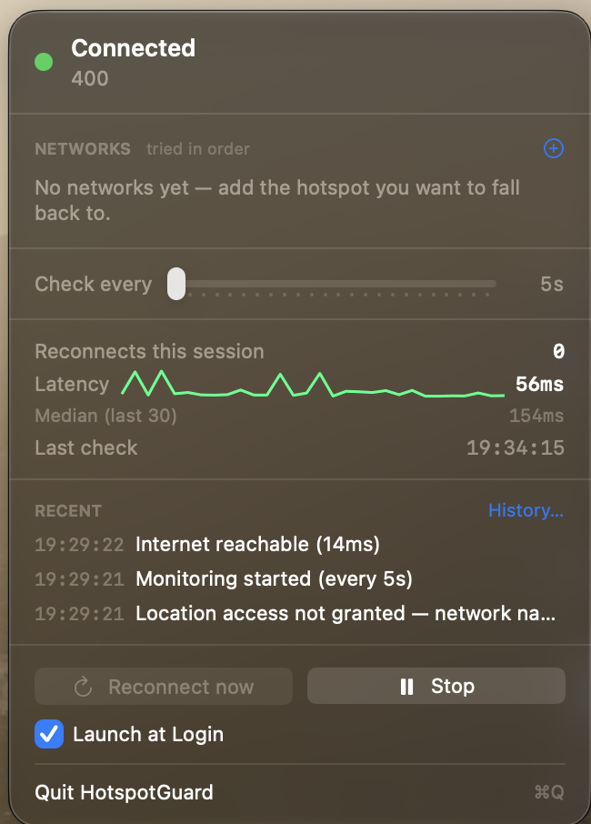

# HotspotGuard

Menu bar watchdog для macOS: стежить за інтернет-з'єднанням і автоматично
перепідключається до заданого Wi-Fi хотспота, коли зв'язок пропадає.

Іконка в menu bar показує стан: **зелена** — інтернет є, **жовта** — триває
спроба перепідключення, **червона** — з'єднання втрачено, **сіра** — моніторинг
вимкнено.



> [!IMPORTANT]
> **Не працює зі сплячим iPhone-хотспотом**, і це не виправляється кодом.
> Коли останній клієнт відключається, iOS вимикає Wi-Fi-радіо телефону; у меню
> Mac він далі видно, але через Bluetooth (Instant Hotspot), а не в ефірі.
> CoreWLAN сканує ефір і не має API, щоб розбудити телефон.
> Для цього випадку вмикайте System Settings › Wi-Fi ›
> **«Ask to join hotspots» → Automatically** — система вміє те, чого не вміє
> жоден сторонній застосунок. Подробиці: [Відомі обмеження](#відомі-обмеження).
>
> Застосунок розрахований на мережі, які **є в ефірі**, але без інтернету:
> завислий роутер, впалий аплінк, captive portal. Там macOS не робить нічого,
> бо формально все гаразд.

## Мінімальна версія: macOS 14.0 (Sonoma)

Не 13, і це усвідомлений вибір:

- **`@Observable`** (Observation framework) — macOS 14+. Саме він дозволяє
  `HotspotGuardCore` не залежати від SwiftUI/Combine: той самий
  `ConnectionManager` живить menu bar сьогодні і зможе живити CLI завтра.
- **CoreWLAN змінився в Sonoma**: з 14.0 читання `CWInterface.ssid()` і
  `scanForNetworks` вимагають авторизації геолокації. Таргет 14 = одна модель
  поведінки без розгалужень `if #available`.
- **`MenuBarExtra(.window)`** на macOS 13 має баги з фокусом `TextField`, а тут
  поля вводу живуть прямо в дропдауні.

`SMAppService` доступний з 13, тож не він визначає нижню межу.

## Збірка

Xcode **не потрібен** — вистачає Command Line Tools (`xcode-select --install`).

```bash
./scripts/build-app.sh
```

Результат: `.build/HotspotGuard.app`, підписаний ad-hoc.

Корисні варіанти:

```bash
./scripts/build-app.sh --install --run
```

```bash
CONFIGURATION=debug ./scripts/build-app.sh
```

```bash
DEVELOPER_ID="Developer ID Application: Ім'я (TEAMID)" ./scripts/build-app.sh
```

### Чому потрібен скрипт, а не просто `swift build`

SwiftPM видає голий бінарник, а menu bar застосунку потрібен бандл: `LSUIElement`,
рядки-пояснення для Location і bundle identifier живуть в `Info.plist`, а TCC,
Keychain і `SMAppService` ідентифікують застосунок саме за identifier + підписом.
Скрипт збирає, загортає і підписує.

### Якщо у вас є Xcode

Проєкт відкривається як SwiftPM package: `File → Open…` і вибрати теку
`hotspot-guard`. Схема `HotspotGuard` збереться, але для повноцінного `.app`
все одно потрібен `build-app.sh` (Xcode не знає про наш `Info.plist`).

## Тести

```bash
swift run hotspotguard-selftest
```

330+ перевірок: `AppSettings` (включно з міграцією зі старого формату),
`EventLog`, `KeychainHelper` (включно з in-memory mock для машин без Keychain),
`CredentialsStore`, `TCPConnectivityProbe` і `ConnectionManager` — успішний
реконект, captive portal, серія невдач із однією нотифікацією, відсутній
пароль, start/stop, захист від паралельних спроб, backoff, реакція на зміну
мережевого шляху, сон/пробудження, вимір затримки та перебір мереж за
пріоритетом, — а також `LocationAuthorization`, `UserNotificationPresenter`,
`WiFiController`, спостерігач мережевого шляху й `AnalyticsStore`/`AnalyticsExport`
(аптайм, відвали, перцентилі, персистентність, формати експорту).

Сьют розкладено по файлах за тестованим типом: `AppSettingsTests.swift`,
`KeychainHelperTests.swift`, `ConnectionManagerTests.swift` тощо. Новий сьют —
це новий файл `<Тип>Tests.swift` з функцією `run<Тип>Tests()`, яку викликає
`main.swift`. Спільні фабрики (`makeManager`, `makeMultiManager`) живуть у
`TestSupport.swift`, двійники — у `Fakes.swift`. Конвенцію перевіряє
`./scripts/check-test-layout.sh` (pre-commit і CI): вона також ловить файл
сьюту, який `main.swift` забув викликати, — інакше тести мовчки не бігли б.
Наприкінці прогону друкується тривалість кожного сьюту й загальний час, тож
сьют, що раптом сповільнився, помітний навіть коли всі перевірки зелені.
`./scripts/flaky-check.sh` проганяє весь набір п'ять разів і падає, якщо
результат хоч раз відрізняється (статус чи кількість перевірок) — так ловлять
тести, що потай залежать від таймінгу чи мережі.

Тести — це executable, а не `.testTarget`, бо і XCTest, і swift-testing
поставляються всередині Xcode. На машині з самими Command Line Tools
`swift test` не працює взагалі, а `swift run hotspotguard-selftest` — працює.
Вихідний код повертає ненульовий статус при падінні, тож для CI цього досить.

### Тести перевірені на здатність падати

Тест, який ніколи не падав, нічого не гарантує. Тому кожне виправлення було
тимчасово прибране, щоб переконатись, що відповідний тест реагує:

| Прибрати | Тест каже |
| --- | --- |
| guard `isWorking` у `tick`/`reconnectNow` | `expected 1, got 2` — подвійна асоціація |
| `draft = ""` назад у `ssidChanged` | `expected newpassword, got ` |

Перша версія тесту на паралельність мала власний дефект: фейкова проба
блокувалась назавжди, тож регресія **вішала** набір замість того, щоб його
завалити. Зависла CI-задача діагностується гірше за червону, тому `GatedProbe`
тепер відкривається сама по дедлайну (`autoOpenAfter`).

## Лінтер і форматер

Код перевіряється [SwiftLint](https://github.com/realm/SwiftLint) і
форматується [swift-format](https://github.com/swiftlang/swift-format):

```bash
brew install swiftlint swift-format periphery
./scripts/lint.sh            # аналіз
./scripts/format.sh          # переписати файли за стилем
./scripts/format.sh --check  # лише перевірити (для CI)
./scripts/dead-code.sh       # непотрібний код (Periphery)
./scripts/duplicates.sh      # копіпаста (jscpd, через npx)
```

`duplicates.sh` проганяє jscpd і падає, коли дубльованих рядків більше 1%.
Саме вона знайшла, що згортання невидимих символів SSID існувало двічі —
тепер це спільний `String.foldingInvisibleSSIDCharacters()`, а два публічні
нормалізатори свідомо відрізняються лише фінальним кроком (NFC проти
lowercase).

`dead-code.sh` шукає оголошення, на які не посилається жоден шлях у коді, і
падає з ненульовим статусом, коли знаходить. Публічний API `HotspotGuardCore`
свідомо не вважається мертвим (див. `.periphery.yml`): це поверхня бібліотеки,
на якій житиме майбутній CLI. Саме ця перевірка знайшла й прибрала залишки
рефакторингів — невикористану `LabeledField`, зайве поле `settings` у
`StatisticsSection` і сетер, який не викликав жоден тест.

Скрипт `lint.sh` сам виставляє `XCODE_DEFAULT_TOOLCHAIN_OVERRIDE` — без нього
на машині зі звичайними Command Line Tools (без Xcode) SwiftLint не знаходить
SourceKit. swift-format такого не потребує, бо працює на SwiftSyntax.

Стиль зафіксований у `.swift-format` (4 пробіли, 120 колонок, наявні
свідомі переноси рядків зберігаються). Перед комітом проганяйте
`./scripts/format.sh` — diff після нього має бути порожнім.

### Фічефлаги

Флаги (`FeatureFlags.swift`) — це не налаштування користувача, а аварійні
вимикачі: вимкнути фічу на конкретній машині чи в QA без нової збірки.
Пріоритет: аргумент запуску `-<flag> true|false` → `defaults write`
`flags.<flag>` → вбудоване значення (увімкнено). Наразі два:
`captivePortalDetection` (перевірка перехоплення після асоціації) і
`connectionHistory` (вікно історії та кнопка «History…»).

```bash
defaults write com.yaroslavkv.hotspotguard flags.captivePortalDetection -bool false
```

## CI

GitHub Actions (`.github/workflows/ci.yml`) проганяє на macOS-раннері ті самі
скрипти, що й локально: перевірку формату, SwiftLint, jscpd, перевірку
тестового лейауту, Periphery і всі 330+ перевірок. Дві паралельні задачі
(`quality` і `test`), кожна помітно швидша за десять хвилин.

Збірка кешується між прогонами (`actions/cache` на `.build`, інкрементальні
збірки), а тривалість `swift build` і selftest-у пишеться в підсумок задачі —
історія часів збірки видна прямо на GitHub і деградація помітна одразу.

### Покриття

`./scripts/coverage.sh` збирає selftest з LLVM-інструментацією
(`-profile-generate`, XCTest не потрібен), проганяє всі 330+ перевірок й міряє
рядкове покриття `HotspotGuardCore` через `llvm-cov`. Ворота — 60% (заміряно
68.6% на момент запровадження; запас лишено під headless-CI, де Keychain-сьюти
пропускаються). Падає нижче порогу — падає CI.

Кожен PR автоматично рев'юїть Droid (`.github/workflows/droid-review.yml`,
deep-прохід). Одноразова підготовка: встановити GitHub App
([app.factory.ai](https://app.factory.ai/settings/integrations/github/start))
і додати секрет `FACTORY_API_KEY`
([ключі](https://app.factory.ai/settings/api-keys)).

### Релізи

Реліз — одна команда: `./scripts/release.sh 1.1.0`. Скрипт перевіряє, що
дерево чисте і `main` синхронізований з origin, проганяє повний локальний
гейт (формат, лінт, копіпаста, лейаут, Periphery, збірка, 199 перевірок),
підіймає версію в `Resources/Info.plist`, комітить, ставить анотований тег і
пушить. Тег запускає `.github/workflows/release.yml`: він звіряє версію тега
з Info.plist, збирає `.app`, пакує його в zip і створює GitHub Release з
автоматично згенерованими нотатками (коміти й PR з попереднього тега). З
репозиторійним секретом `DEVELOPER_ID` підпис справжній; без нього — ad-hoc,
як у локальній збірці.

### Pre-commit гачки

Швидкі перевірки (формат, лінт і копіпаста) можуть бігати автоматично при
коміті через [pre-commit](https://pre-commit.com) (конфіг —
`.pre-commit-config.yaml`):

```bash
brew install pre-commit
pre-commit install
```

Periphery туди свідомо не включено: повний індексний аналіз триває хвилини,
а коміт-гачок має бути швидким. Мертвий код — це перевірка для CI.

Конфігурація — `.swiftlint.yml` у корені. Вона фіксує кілька домовленостей
проєкту:

- **Цикломатична складність ≤ 10** (попередження). Складніші функції треба
  ділити — саме так `attemptReconnect()` віддав післяасоціативну перевірку
  в `confirmConnectivity(ssid:)`.
- **Іменування зафіксовано правилами `identifier_name` і `type_name`**:
  lowerCamelCase для змінних і функцій, UpperCamelCase для типів, мінімум
  три символи — без винятків, короткі імена перейменовуються (`ms` →
  `milliseconds`, `x`/`y` → `pointX`/`pointY`). Поверх цього в коді діють
  префіксні домовленості: `locked*` — сховище, яке чіпають лише тримаючи
  NSLock; `Fake*`/`Scripted*`/`Gated*` — тестові двійники у `Fakes.swift`.
- **TODO/FIXME — завжди попередження.** Маркери техборгу дозволені, але
  кожен лишається видимим у звіті лінтера, доки його не розв'яжуть. Це і є
  трекінг техборгу в цьому репозиторії: жоден маркер не накопичується
  непомічено.
- **Trailing comma обов'язкова** у багаторядкових літералах — diff при
  додаванні елемента лишається однорядковим.
- **Довжина файла (400), типу (350), функції (50)** — попередження на
  стандартних порогах; вони свідомо лишаються видимими для кількох файлів
  замість того, щоб бути заглушеними.

## Дозволи

### Location — обов'язковий

При першому запуску macOS спитає дозвіл на геолокацію. Це не помилка і не
телеметрія.

Набір Wi-Fi мереж навколо вас визначає ваше положення з точністю до кварталу —
саме так працює база геолокації Apple. Тому з macOS Sonoma система закриває
доступ до будь-якого API, що показує сусідні мережі, за Location Services. Без
цього дозволу:

- `CWInterface.ssid()` повертає `nil` навіть коли Wi-Fi підключений — ви не
  побачите назву мережі;
- `scanForNetworks` падає з «not permitted» — а це повністю блокує
  перепідключення.

Застосунок ніколи не читає координати; він лише запитує дозвіл, щоб CoreWLAN
почав відповідати.

Якщо випадково відмовили: **System Settings › Privacy & Security › Location
Services › HotspotGuard**.

### Notifications

Запитується при першому запуску. Використовується лише щоб попередити після
трьох невдалих спроб поспіль. Відмова нічого не ламає — події все одно
пишуться в History.

## Відомі обмеження

### Сплячий iPhone-хотспот — не працює, і не запрацює

Найважливіше обмеження, і воно принципове.

Якщо iPhone показаний у меню Wi-Fi окремою секцією **Personal Hotspot** — з
іконкою ланцюжка, написом `5G` і зарядом батареї — це **Instant Hotspot**,
механізм Continuity. Заряд батареї і тип стільникової мережі не передаються в
Wi-Fi beacon; ця інформація приходить **по Bluetooth**. Тобто macOS показує
телефон не тому, що чує його в ефірі.

Що відбувається насправді:

1. Останній клієнт відключається від хотспота
2. Через кілька хвилин iOS глушить Wi-Fi-радіо телефону заради батареї —
   вимикач «Allow Others to Join» цьому не заважає, він лише дозволяє
   підключення, а не змушує радіо працювати цілодобово
3. У меню Mac телефон досі видно, бо Bluetooth-канал живий
4. Клік у меню будить телефон **по Bluetooth**

`CWInterface.scanForNetworks` сканує радіоефір, і там справді порожньо. Асоціація
можлива лише з об'єктом `CWNetwork`, а взяти його можна тільки зі скану: немає
скану — немає об'єкта — немає підключення. Публічного API, щоб розбудити Instant
Hotspot, не існує. `networksetup` на тому ж рівні й теж не допоможе.

Симптом, за яким це впізнається миттєво: **поки Mac підключений до хотспота,
`Reconnect now` працює; щойно відключився — «not broadcasting»**. Підключений
клієнт утримує радіо телефону активним, і скан його бачить.

**Штатне рішення — не цей застосунок:** System Settings › Wi-Fi ›
**«Ask to join hotspots» → Automatically**. Системний механізм уміє будити
телефон по Bluetooth, бо має доступ до Continuity.

Де застосунок усе ж корисний: коли Mac підключений до звичайної мережі, яка
формально жива, але без інтернету — завислий роутер, впав аплінк, captive
portal. macOS вважає, що все гаразд, і не робить нічого. Перевірка справжнім
TCP-хендшейком це ловить, і мережа при цьому в ефірі, тож реконект спрацює.

### Решта

**CoreWLAN не гарантує повну відсутність діалогів.** `associate(to:password:)`
працює тихо для мережі, яку macOS уже знає, але приєднання до невідомої мережі
може викликати системний запит авторизації. Обхід: один раз підключіться до
хотспота вручну — мережа потрапить у список збережених, і подальші реконекти
йтимуть без питань. Це все одно значно краще за `networksetup
-setairportnetwork`, який просить пароль адміністратора **щоразу**.

**Launch at Login на ad-hoc підписі часто не працює.** `SMAppService.register()`
повертає помилку, бо launchd перевіряє підпис перед встановленням login item.
Помилка показується в меню, а не ковтається. Обхід — додати застосунок вручну:
**System Settings › General › Login Items › +**. З реальним Developer ID
перемикач працює штатно.

**Ключ Keychain нормалізується.** Пароль зберігається під канонічним SSID:
типографські апострофи (`U+2019`, як в `Anna’s iPhone`) зводяться до звичайного,
нерозривні пробіли — до звичайних, застосовується NFC. Регістр **не** чіпається,
бо SSID чутливі до регістру за стандартом і `MyNet` з `mynet` не повинні ділити
пароль — цим нормалізація ключа відрізняється від `CoreWLANController.normalize`,
яка робить `lowercased()` для зіставлення з ефіром.

Спостереження з практики: `SecItemCopyMatching` і сам повертає імена акаунтів у
згорнутій формі — навіть для запису, у якого `security` CLI показує сирі байти
`E28099` у blob. Два API розходяться в тому, як подають один і той самий запис.
Тому одноразовий прохід `migrateToNormalizedKeys()` на практиці зазвичай нічого
не робить; він лишений на випадок, коли згортання не відбудеться, бо ціна
помилки — пароль, який мовчки не знаходиться.

**Ad-hoc підпис змінюється при кожній перезбірці.** macOS сприймає новий білд як
інший застосунок, тож дозвіл на Location доведеться давати знову, а Keychain
може перепитати доступ. З постійним Developer ID цього немає.

**App Sandbox вимкнено.** CoreWLAN `associate` під сендбоксом потребує
entitlements, недоступних без платного Developer-акаунта.

## Архітектура

Два таргети, і межа між ними — не косметична: компілятор фізично не дасть
затягнути AppKit у ядро.

```
Sources/
├── HotspotGuardCore/          # жодного імпорту AppKit/SwiftUI
│   ├── ConnectionManager.swift    # стан-машина, цикл, backoff, перебір мереж
│   ├── ConnectivityProbe.swift    # protocol + NWConnection + captive portal
│   ├── ConnectivityResult.swift   # статус + затримка
│   ├── HotspotNetwork.swift       # один запис у списку пріоритетів
│   ├── SleepWakeObserver.swift    # protocol (реалізація в UI, бо AppKit)
│   ├── WiFiController.swift       # protocol + CoreWLAN-реалізація
│   ├── NetworkPathObserver.swift  # protocol + NWPathMonitor
│   ├── CredentialsStore.swift     # правила роботи з паролем
│   ├── PasswordStorage.swift      # protocol + Keychain + нормалізація ключа
│   ├── KeychainHelper.swift       # Security framework
│   ├── LocationAuthorization.swift
│   ├── Notifications.swift        # protocol + UserNotifications
│   ├── Settings.swift             # AppSettings (UserDefaults)
│   ├── EventLog.swift             # кільцевий буфер на 20 подій
│   └── Defaults.swift             # константи
└── HotspotGuard/              # UI
    ├── App.swift                  # @main, AppModel, MenuBarExtra
    ├── MenuBarView.swift          # дропдаун
    ├── HistoryView.swift          # вікно History
    ├── NetworkListSection.swift   # список мереж із пріоритетом
    ├── WorkspaceSleepWakeObserver.swift  # NSWorkspace sleep/wake
    ├── LaunchAtLogin.swift        # SMAppService
    └── StatusIcon.swift           # кольорова іконка
```

`ConnectivityProbe`, `WiFiController`, `NetworkPathObserver` і `PasswordStorage`
— протоколи, і саме це робить логіку тестованою: підставляємо фейк, який каже
«інтернету немає», і перевіряємо, що менеджер спробував перепідключитись рівно
раз. Інакше перевірити хоч щось можна було б лише сидячи біля справжнього
хотспота з секундоміром.

`CredentialsStore` живе в ядрі, а не в UI, свідомо. Правила «що вважається
збереженим паролем», «що робити при зміні мережі», «чим автентифікуватись» не є
UI-специфічними — CLI потребуватиме тих самих. Поки вони жили всередині
`AppModel`, вони не були покриті тестами, і саме там вижив баг, коли редагування
назви мережі мовчки стирало набраний пароль.

CLI-фронтенд у майбутньому — це третій таргет, що лінкує тільки `HotspotGuardCore`;
`ConnectionManager.tick()` уже публічний саме для одноразової перевірки без циклу.

### Backoff і реакція на зміну мережі

Ці дві речі працюють у парі, і поодинці кожна була б гіршою.

**Backoff.** Якщо хотспот просто вимкнений — телефон у кишені, ви в метро — без
сповільнення застосунок нескінченно робив би повний цикл кожні N секунд:
проба → сканування ефіру → спроба асоціації. Сканування Wi-Fi не безкоштовне:
радіо перемикається по каналах, це помітно для батареї, і на частині адаптерів
зачіпає поточну асоціацію. Інтервал подвоюється з кожною невдачею поспіль до
стелі в 5 хвилин і повертається до заданого при першому успіху.

**Зміна мережевого шляху.** `NWPathMonitor` повідомляє про появу чи зникнення
маршруту за мілісекунди, і це підтягує наступну перевірку наперед. Саме тому
п'ятихвилинний backoff прийнятний: коли Wi-Fi справді повертається, перевірка
відбувається негайно, а не наприкінці витримки.

Шлях повідомляє лише про *наявність* маршруту — captive portal виглядає цілком
«satisfied» — тому рішення про зв'язок завжди приймає проба, а подія від системи
є тільки тригером. Плюс обмеження частоти, щоб мерехтливий інтерфейс не
влаштував шторм сканувань.

Коли backoff активний, меню показує це явно (`Backing off after N failures` з
реальним інтервалом). Інакше інтерфейс стверджував би «every 10s», поки
перевірки насправді йдуть раз на кілька хвилин.

### Чому TCP, а не ICMP ping

Справжній `ping` потребує raw-сокетів і власноруч зібраного ICMP-пакета — і при
цьому відповідає не на те питання. Captive portal спокійно пропускає ICMP,
блокуючи все інше, тому ping каже «онлайн» саме там, де ви офлайн. Завершений
TCP-хендшейк до зовнішнього хоста — сильніший сигнал і не потребує привілеїв.
Пробуються `1.1.1.1:443` і `8.8.8.8:53` паралельно, перший успіх виграє.

### Де що зберігається

| Дані | Де | Чому |
| --- | --- | --- |
| SSID, інтервал, стан моніторингу | `UserDefaults` | несекретне |
| Пароль хотспота | Keychain (`kSecClassGenericPassword`) | `UserDefaults` — це звичайний plist, який читає будь-який процес користувача |

Ключ Keychain — пара (service = bundle ID, account = SSID), тож паролі різних
хотспотів не перетирають один одного. Пароль ніколи не потрапляє в лог подій.

## Використання

1. Клік на іконку в menu bar.
2. **NETWORKS › +** — додайте мережу за назвою (SSID). Одразу після додавання
   відкриється поле пароля.
3. Введіть пароль і натисніть **⏎** або ✓. Замок 🔒 біля мережі означає, що
   пароль у Keychain; ⚠️ — що пароля немає і реконект на цю мережу не спрацює.
4. **Check every** — базовий інтервал перевірки, 5–120 с (за замовчуванням 10).
   При повторних невдачах він автоматично зростає — див. «Backoff» вище.
5. **Start** — запустити моніторинг. Стан зберігається між запусками.

**Reconnect now** — ручний тригер; неактивний, поки триває чергова перевірка.
**History…** — усі 20 останніх подій, а зверху — аналітика: аптайм за добу,
відвали за тиждень із сумарним даунтаймом, латентність p50/p95, розріз по
мережах, плюс експорт історії у CSV/JSON.

### Кілька мереж і пріоритет

Список упорядкований, і порядок — це порядок спроб. Стрілки ↑↓ переміщують
мережу, ✕ прибирає її зі списку.

При обриві застосунок іде списком згори вниз і зупиняється на першій, яка дала
робочий інтернет. Мережі без збереженого пароля пропускаються, не витрачаючи
спробу.

Сканування ефіру займає секунди, тому воно не повторюється для кожної мережі:
перший скан, що нічого не знайшов, повертає список усього, що є в ефірі, і
решта кандидатів звіряється з ним без власного скану.

Видалення мережі зі списку **не стирає** її пароль із Keychain — якщо додасте її
знову, пароль підхопиться. Це навмисно: прибрати мережу зі списку і знищити
секрет — різні наміри.

### Оновлення з попередньої версії

Раніше зберігався один SSID. При першому запуску нової версії він автоматично
стає першим записом у списку — з точністю до символу, включно з типографським
апострофом в іменах на кшталт `Anna's iPhone`. Це важливо, бо
запис у Keychain прив'язаний саме до цього рядка; будь-яка «нормалізація» під
час міграції осиротила б пароль.

## Ліцензія

MIT — див. [LICENSE](LICENSE).
