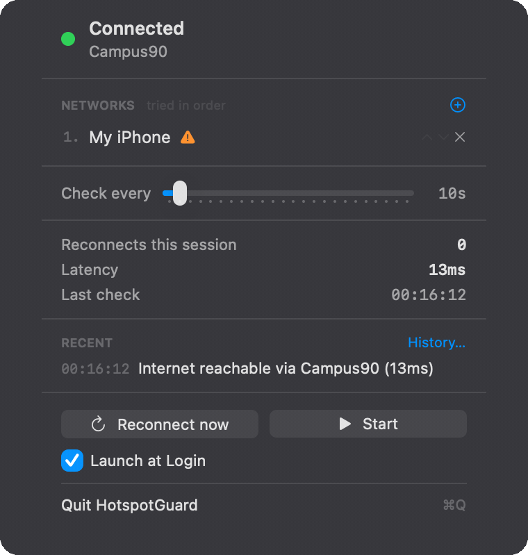
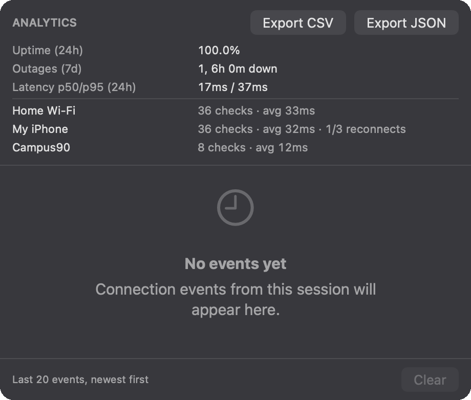

# HotspotGuard

macOS menu bar watchdog: monitors internet connection and automatically reconnects to a specified Wi-Fi hotspot when the connection is lost.

The menu bar icon shows the status: **green** — internet is available, **yellow** — reconnection attempt in progress, **red** — connection lost, **gray** — monitoring disabled.


*Меню HotspotGuard: статус зʼєднання, список мереж у порядку спроб, графік затримки та останні події.*



*Наживо: графік затримки росте з кожною перевіркою, оновлюються медіана, час останньої перевірки та події.*



*Вікно History: аналітика за тиждень (аптайм, відвали, p50/p95, розріз по мережах) та експорт у CSV/JSON. Аналітика зберігається між запусками, події — лише за сесію.*

> [!IMPORTANT]
> **Does not work with a sleeping iPhone hotspot**, and this cannot be fixed by code.
> When the last client disconnects, iOS turns off the phone's Wi-Fi radio; it remains visible in the Mac menu, but via Bluetooth (Instant Hotspot), not on the air.
> CoreWLAN scans the air and has no API to wake up the phone.
> For this case, enable System Settings › Wi-Fi ›
> **"Ask to join hotspots" → Automatically** — the system can do what no third-party app can. Details: [Known Limitations](#known-limitations).
>
> The app is designed for networks that **are on the air**, but without internet:
> a frozen router, dropped uplink, captive portal. There macOS does nothing,
> because formally everything is fine.

## Minimum version: macOS 14.0 (Sonoma)

Not 13, and this is a deliberate choice:

- **`@Observable`** (Observation framework) — macOS 14+. This allows
  `HotspotGuardCore` to not depend on SwiftUI/Combine: the same
  `ConnectionManager` powers the menu bar today and can power a CLI tomorrow.
- **CoreWLAN changed in Sonoma**: from 14.0, reading `CWInterface.ssid()` and
  `scanForNetworks` require Location authorization. Target 14 = one behavior model
  without `if #available` branches.
- **`MenuBarExtra(.window)`** on macOS 13 has bugs with `TextField` focus, and here
  input fields live directly in the dropdown.

`SMAppService` is available from 13, so it's not what determines the lower bound.

## Building

Xcode is **not required** — Command Line Tools is enough (`xcode-select --install`).

```bash
./scripts/build-app.sh
```

Result: `.build/HotspotGuard.app`, ad-hoc signed.

Useful options:

```bash
./scripts/build-app.sh --install --run
```

```bash
CONFIGURATION=debug ./scripts/build-app.sh
```

```bash
DEVELOPER_ID="Developer ID Application: Name (TEAMID)" ./scripts/build-app.sh
```

### Why a script is needed, and not just `swift build`

SwiftPM outputs a bare binary, but a menu bar app needs a bundle: `LSUIElement`,
explanation strings for Location, and bundle identifier live in `Info.plist`, and TCC,
Keychain, and `SMAppService` identify the app specifically by identifier + signature.
The script builds, wraps, and signs.

### If you have Xcode

The project opens as a SwiftPM package: `File → Open…` and select the
`hotspot-guard` folder. The `HotspotGuard` scheme will build, but for a full `.app`
`build-app.sh` is still needed (Xcode doesn't know about our `Info.plist`).

## Tests

```bash
swift run hotspotguard-selftest
```

192 checks: `AppSettings` (including migration from the old format),
`EventLog`, `KeychainHelper`, `CredentialsStore`, `TCPConnectivityProbe`, and
`ConnectionManager` — successful reconnect, captive portal, a series of failures with one
notification, missing password, start/stop, protection against parallel attempts,
backoff, reaction to network path changes, sleep/wake, latency measurement, and
iterating through networks by priority.

The suite is divided into files by tested type: `AppSettingsTests.swift`,
`KeychainHelperTests.swift`, `ConnectionManagerTests.swift`, etc. A new suite
is a new `<Type>Tests.swift` file with a `run<Type>Tests()` function, which is called by
`main.swift`. Shared factories (`makeManager`, `makeMultiManager`) live in
`TestSupport.swift`, doubles in `Fakes.swift`. The convention is checked by
`./scripts/check-test-layout.sh` (pre-commit and CI): it also catches a suite
file that `main.swift` forgot to call — otherwise tests would silently not run.
At the end of the run, the duration of each suite and the total time are printed, so
a suite that suddenly slowed down is noticeable even when all checks are green.
`./scripts/flaky-check.sh` runs the whole set five times and fails if
the result differs even once (status or number of checks) — this catches
tests that secretly depend on timing or network.

Tests are an executable, not a `.testTarget`, because both XCTest and swift-testing
are bundled inside Xcode. On a machine with only Command Line Tools,
`swift test` doesn't work at all, but `swift run hotspotguard-selftest` works.
The exit code is non-zero on failure, which is enough for CI.

### Tests are verified for their ability to fail

A test that never failed guarantees nothing. Therefore, every fix was
temporarily removed to make sure the corresponding test reacts:

| Remove | Test says |
| --- | --- |
| guard `isWorking` in `tick`/`reconnectNow` | `expected 1, got 2` — double association |
| `draft = ""` back in `ssidChanged` | `expected newpassword, got ` |

The first version of the concurrency test had its own defect: the fake probe
blocked forever, so the regression **hung** the suite instead of failing it.
A hung CI job is harder to diagnose than a red one, so `GatedProbe`
now opens itself by deadline (`autoOpenAfter`).

## Linter and formatter

The code is checked by [SwiftLint](https://github.com/realm/SwiftLint) and
formatted by [swift-format](https://github.com/swiftlang/swift-format):

```bash
brew install swiftlint swift-format periphery
./scripts/lint.sh            # analysis
./scripts/format.sh          # rewrite files according to style
./scripts/format.sh --check  # check only (for CI)
./scripts/dead-code.sh       # unused code (Periphery)
./scripts/duplicates.sh      # copy-paste (jscpd, via npx)
```

`duplicates.sh` runs jscpd and fails when duplicated lines exceed 1%.
It was the one that found that folding invisible SSID characters existed twice —
now it's a shared `String.foldingInvisibleSSIDCharacters()`, and the two public
normalizers intentionally differ only in the final step (NFC vs
lowercase).

`dead-code.sh` looks for declarations not referenced by any path in the code, and
fails with a non-zero status when found. The public API of `HotspotGuardCore`
is intentionally not considered dead (see `.periphery.yml`): this is the library surface
where the future CLI will live. It was this check that found and removed remnants
of refactorings — unused `LabeledField`, an extra `settings` field in
`StatisticsSection`, and a setter not called by any test.

The `lint.sh` script itself sets `XCODE_DEFAULT_TOOLCHAIN_OVERRIDE` — without it,
on a machine with standard Command Line Tools (without Xcode), SwiftLint won't find
SourceKit. swift-format doesn't need this, as it works on SwiftSyntax.

The style is fixed in `.swift-format` (4 spaces, 120 columns, existing
intentional line breaks are preserved). Before committing, run
`./scripts/format.sh` — the diff after it should be empty.

### Feature flags

Flags (`FeatureFlags.swift`) are not user settings, but emergency
kill switches: to disable a feature on a specific machine or in QA without a new build.
Priority: launch argument `-<flag> true|false` → `defaults write`
`flags.<flag>` → built-in value (enabled). Currently there are two:
`captivePortalDetection` (checking for interception after association) and
`connectionHistory` (history window and "History..." button).

```bash
defaults write com.yaroslavkv.hotspotguard flags.captivePortalDetection -bool false
```

## CI

GitHub Actions (`.github/workflows/ci.yml`) runs the same
scripts on a macOS runner as locally: format check, SwiftLint, jscpd, test
layout check, Periphery, and all 192 checks. Two parallel jobs
(`quality` and `test`), each noticeably faster than ten minutes.

The build is cached between runs (`actions/cache` on `.build`, incremental
builds), and the duration of `swift build` and the selftest is written to the job summary —
the history of build times is visible directly on GitHub and degradation is noticeable immediately.

### Coverage

`./scripts/coverage.sh` builds the selftest with LLVM instrumentation
(`-profile-generate`, XCTest not required), runs all 192 checks, and measures
line coverage of `HotspotGuardCore` via `llvm-cov`. The gate is 60% (measured
at 68.6% at the time of introduction; a margin left for headless CI, where Keychain suites
are skipped). Drops below the threshold — CI fails.

Every PR is automatically reviewed by Droid (`.github/workflows/droid-review.yml`,
deep pass). One-time setup: install the GitHub App
([app.factory.ai](https://app.factory.ai/settings/integrations/github/start))
and add the `FACTORY_API_KEY` secret
([keys](https://app.factory.ai/settings/api-keys)).

### Releases

A release is a single command: `./scripts/release.sh 1.1.0`. The script checks that
the tree is clean and `main` is synced with origin, runs the full local
gate (format, lint, copy-paste, layout, Periphery, build, 199 checks),
bumps the version in `Resources/Info.plist`, commits, creates an annotated tag, and
pushes. The tag triggers `.github/workflows/release.yml`: it verifies the tag version
against Info.plist, builds `.app`, packs it into a zip, and creates a GitHub Release with
auto-generated notes (commits and PRs since the previous tag). With
the repository secret `DEVELOPER_ID`, the signature is real; without it — ad-hoc,
just like the local build.

### Pre-commit hooks

Fast checks (format, lint, and copy-paste) can run automatically on
commit via [pre-commit](https://pre-commit.com) (config —
`.pre-commit-config.yaml`):

```bash
brew install pre-commit
pre-commit install
```

Periphery is intentionally not included there: a full index analysis takes minutes,
and a commit hook should be fast. Dead code is a check for CI.

Configuration — `.swiftlint.yml` in the root. It fixes several project
agreements:

- **Cyclomatic complexity ≤ 10** (warning). More complex functions should
  be split — this is exactly how `attemptReconnect()` delegated post-association checking
  to `confirmConnectivity(ssid:)`.
- **Naming is fixed by `identifier_name` and `type_name` rules**:
  lowerCamelCase for variables and functions, UpperCamelCase for types, minimum
  three characters — no exceptions, short names are renamed (`ms` →
  `milliseconds`, `x`/`y` → `pointX`/`pointY`). On top of this, prefix
  conventions apply in the code: `locked*` — storage touched only while holding
  an NSLock; `Fake*`/`Scripted*`/`Gated*` — test doubles in `Fakes.swift`.
- **TODO/FIXME — always a warning.** Technical debt markers are allowed, but
  each remains visible in the linter report until resolved. This is how
  technical debt tracking works in this repository: no marker accumulates
  unnoticed.
- **Trailing comma is required** in multi-line literals — the diff when
  adding an element remains single-line.
- **Length of file (400), type (350), function (50)** — warnings on
  standard thresholds; they deliberately remain visible for a few files
  instead of being silenced.

## Permissions

### Location — required

On the first launch, macOS will ask for location permission. This is not an error and not
telemetry.

The set of Wi-Fi networks around you determines your position with block-level accuracy —
this is exactly how Apple's geolocation database works. Therefore, starting from macOS Sonoma, the system gates
access to any API that exposes nearby networks behind Location Services. Without
this permission:

- `CWInterface.ssid()` returns `nil` even when Wi-Fi is connected — you won't
  see the network name;
- `scanForNetworks` fails with "not permitted" — and this completely blocks
  reconnection.

The app never reads coordinates; it only requests permission so that CoreWLAN
will start answering.

If you accidentally denied it: **System Settings › Privacy & Security › Location
Services › HotspotGuard**.

### Notifications

Requested on the first launch. Used only to warn after
three consecutive failed attempts. Denial doesn't break anything — events are still
written to History.

## Known Limitations

### Sleeping iPhone hotspot — does not work, and will not work

The most important limitation, and it is fundamental.

If an iPhone is shown in the Wi-Fi menu as a separate section **Personal Hotspot** — with
a chainlink icon, a `5G` label, and battery charge — this is **Instant Hotspot**,
a Continuity mechanism. Battery charge and cellular network type are not transmitted in
a Wi-Fi beacon; this information arrives **via Bluetooth**. That means macOS shows
the phone not because it hears it on the air.

What actually happens:

1. The last client disconnects from the hotspot
2. After a few minutes, iOS turns off the phone's Wi-Fi radio to save battery —
   the "Allow Others to Join" switch does not prevent this, it only allows
   connections, but does not force the radio to work 24/7
3. The phone is still visible in the Mac menu because the Bluetooth channel is alive
4. Clicking in the menu wakes the phone **via Bluetooth**

`CWInterface.scanForNetworks` scans the radio air, and it's actually empty there. Association
is possible only with a `CWNetwork` object, and it can only be obtained from a scan: no
scan — no object — no connection. A public API to wake up an Instant
Hotspot does not exist. `networksetup` is on the same level and won't help either.

The symptom by which this is instantly recognizable: **while the Mac is connected to the hotspot,
`Reconnect now` works; as soon as it disconnects — "not broadcasting"**. A connected
client keeps the phone's radio active, and the scan sees it.

**The standard solution is not this app:** System Settings › Wi-Fi ›
**"Ask to join hotspots" → Automatically**. The system mechanism can wake up
the phone via Bluetooth because it has access to Continuity.

Where the app is still useful: when the Mac is connected to a regular network that is
formally alive but without internet — frozen router, dropped uplink, captive
portal. macOS assumes everything is fine and does nothing. A check with a real
TCP handshake catches this, and the network is on the air at the same time, so the reconnect will work.

### The rest

**CoreWLAN does not guarantee a complete absence of dialogs.** `associate(to:password:)`
works quietly for a network macOS already knows, but joining an unknown network
may trigger a system authorization prompt. Workaround: connect to the hotspot manually once —
the network will be added to the saved list, and subsequent reconnects will go without questions.
This is still much better than `networksetup
-setairportnetwork`, which asks for the administrator password **every time**.

**Launch at Login on ad-hoc signature often doesn't work.** `SMAppService.register()`
returns an error because launchd checks the signature before installing a login item.
The error is shown in the menu, rather than being swallowed. Workaround — add the app manually:
**System Settings › General › Login Items › +**. With a real Developer ID,
the switch works normally.

**Keychain key is normalized.** The password is saved under the canonical SSID:
typographic apostrophes (`U+2019`, like in `Anna’s iPhone`) are reduced to a regular one,
non-breaking spaces — to regular ones, NFC is applied. Case is **not** touched,
because SSIDs are case-sensitive by standard and `MyNet` with `mynet` shouldn't share
the password — this is how key normalization differs from `CoreWLANController.normalize`,
which does `lowercased()` to match with the air.

Observation from practice: `SecItemCopyMatching` itself returns account names in
folded form — even for a record where the `security` CLI shows the raw bytes
`E28099` in the blob. The two APIs diverge in how they present the exact same record.
Therefore, the one-time pass of `migrateToNormalizedKeys()` in practice usually does nothing;
it's left in case folding doesn't happen, because the price of an error is a password that is silently not found.

**Ad-hoc signature changes on every rebuild.** macOS perceives the new build as
a different app, so the Location permission will have to be granted again, and Keychain
may ask for access again. This does not happen with a permanent Developer ID.

**App Sandbox is disabled.** CoreWLAN `associate` under a sandbox requires
entitlements unavailable without a paid Developer account.

## Architecture

Two targets, and the boundary between them is not cosmetic: the compiler physically won't
allow pulling AppKit into the core.

```
Sources/
├── HotspotGuardCore/          # no AppKit/SwiftUI imports
│   ├── ConnectionManager.swift    # state machine, loop, backoff, network iteration
│   ├── ConnectivityProbe.swift    # protocol + NWConnection + captive portal
│   ├── ConnectivityResult.swift   # status + latency
│   ├── HotspotNetwork.swift       # a single entry in the priority list
│   ├── SleepWakeObserver.swift    # protocol (implementation in UI, because AppKit)
│   ├── WiFiController.swift       # protocol + CoreWLAN implementation
│   ├── NetworkPathObserver.swift  # protocol + NWPathMonitor
│   ├── CredentialsStore.swift     # password handling rules
│   ├── PasswordStorage.swift      # protocol + Keychain + key normalization
│   ├── KeychainHelper.swift       # Security framework
│   ├── LocationAuthorization.swift
│   ├── Notifications.swift        # protocol + UserNotifications
│   ├── Settings.swift             # AppSettings (UserDefaults)
│   ├── EventLog.swift             # ring buffer for 20 events
│   └── Defaults.swift             # constants
└── HotspotGuard/              # UI
    ├── App.swift                  # @main, AppModel, MenuBarExtra
    ├── MenuBarView.swift          # dropdown
    ├── HistoryView.swift          # History window
    ├── NetworkListSection.swift   # list of networks with priority
    ├── WorkspaceSleepWakeObserver.swift  # NSWorkspace sleep/wake
    ├── LaunchAtLogin.swift        # SMAppService
    └── StatusIcon.swift           # colored icon
```

`ConnectivityProbe`, `WiFiController`, `NetworkPathObserver` and `PasswordStorage`
are protocols, and this is exactly what makes the logic testable: we substitute a fake that says
"no internet", and check that the manager tried to reconnect exactly
once. Otherwise, testing anything would only be possible by sitting near a real
hotspot with a stopwatch.

`CredentialsStore` lives in the core, not in the UI, deliberately. The rules of "what is considered
a saved password", "what to do when changing networks", "what to authenticate with" are not
UI-specific — the CLI will need the same ones. As long as they lived inside
`AppModel`, they weren't covered by tests, and that is exactly where the bug survived where editing
the network name silently erased the typed password.

The CLI frontend in the future is a third target linking only `HotspotGuardCore`;
`ConnectionManager.tick()` is already public specifically for a one-shot check without a loop.

### Backoff and reaction to network change

These two things work in pairs, and either one alone would be worse.

**Backoff.** If the hotspot is simply turned off — the phone is in your pocket, you are on the subway — without
slowing down, the app would infinitely do a full cycle every N seconds:
probe → air scan → association attempt. Wi-Fi scanning is not free:
the radio switches channels, it's noticeable for the battery, and on some adapters
it affects the current association. The interval doubles with each consecutive failure up to
a ceiling of 5 minutes and returns to the set value on the first success.

**Network path change.** `NWPathMonitor` reports the appearance or disappearance
of a route in milliseconds, and this pulls the next check forward. That's why
a five-minute backoff is acceptable: when Wi-Fi actually returns, the check
happens immediately, not at the end of the delay.

The path only reports the *presence* of a route — a captive portal looks completely
"satisfied" — so the connectivity decision is always made by the probe, and the event from the system
is just a trigger. Plus frequency limiting, so a flapping interface doesn't
cause a scan storm.

When backoff is active, the menu shows it explicitly (`Backing off after N failures` with
the actual interval). Otherwise, the UI would claim "every 10s", while
checks are actually happening once every few minutes.

### Why TCP, and not ICMP ping

A real `ping` requires raw sockets and a manually built ICMP packet — and at the same
time it answers the wrong question. A captive portal happily lets ICMP through,
blocking everything else, so ping says "online" exactly where you are offline. A completed
TCP handshake to an external host is a stronger signal and does not require privileges.
`1.1.1.1:443` and `8.8.8.8:53` are probed in parallel, first success wins.

### Where things are stored

| Data | Where | Why |
| --- | --- | --- |
| SSID, interval, monitoring state | `UserDefaults` | non-secret |
| Hotspot password | Keychain (`kSecClassGenericPassword`) | `UserDefaults` is a regular plist that any user process can read |

The Keychain key is a pair (service = bundle ID, account = SSID), so passwords for different
hotspots do not overwrite each other. The password never makes it into the event log.

## Usage

1. Click on the icon in the menu bar.
2. **NETWORKS › +** — add a network by name (SSID). Right after adding,
   the password field will open.
3. Enter the password and press **⏎** or ✓. The lock 🔒 next to the network means that
   the password is in the Keychain; ⚠️ — that there is no password and reconnecting to this network will not work.
4. **Check every** — base check interval, 5–120 s (default 10).
   On repeated failures it automatically increases — see "Backoff" above.
5. **Start** — start monitoring. The state is saved between launches.

**Reconnect now** — manual trigger; inactive while another check is in progress.
**History…** — all 20 recent events.

### Multiple networks and priority

The list is ordered, and the order is the order of attempts. Up/down arrows ↑↓ move
the network, ✕ removes it from the list.

On a disconnect, the app goes down the list from top to bottom and stops at the first one that provides
working internet. Networks without a saved password are skipped without wasting
an attempt.

Air scanning takes seconds, so it is not repeated for every network:
the first scan that finds nothing returns a list of everything on the air, and
the rest of the candidates are checked against it without their own scan.

Removing a network from the list **does not erase** its password from the Keychain — if you add it
again, the password will be picked up. This is intentional: removing a network from the list and destroying
the secret are different intents.

### Updating from a previous version

Previously, a single SSID was stored. On the first launch of the new version, it automatically
becomes the first entry in the list — down to the exact character, including typographic
apostrophes in names like `Anna's iPhone`. This is important because
the Keychain record is tied exactly to this string; any "normalization" during
migration would orphan the password.

## License

MIT — see [LICENSE](LICENSE).
